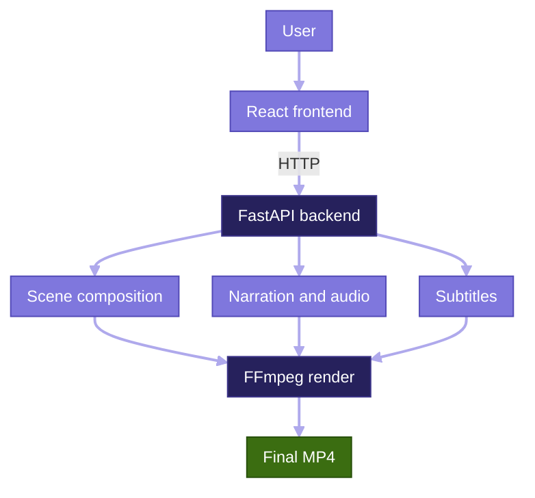

<div align="center">

<h1>Memory Studio</h1>

<p>
  
  
  
  
  
</p>

<p><em>Turn written ideas and personal photos into narrated, scene-based videos, rendered locally.</em></p>

</div>

## 📖 Overview

**Memory Studio** is a web application for creating narrated videos from text and photos. It combines scene composition, voice narration, audio processing, subtitles, and video rendering in a single workflow.

It offers two creation modes:

- **Text-to-Video:** Turn prompts and scripts into scene-based videos with narration and subtitles.
- **Picture-to-Video:** Bring personal photos to life with narration, uploaded audio, or a browser recording of your voice.

Rendering is local-first by default. Cloud and AI integrations are optional.

<br>

## ✨ Features

| | Feature | Description |
|---|---|---|
| 📝 | **Text-to-Video** | Scene-based videos from prompts and scripts, with visual layouts, narration, and subtitles. |
| 🖼️ | **Picture-to-Video** | Personal photos turned into videos with uploaded audio, browser-recorded voice, or TTS. |
| 🎙️ | **Voice & Narration** | Local text-to-speech via Piper, or your own voice through browser recording or file upload. |
| 🎞️ | **Scene Composition** | Text and image layouts with animated Ken Burns pan-and-zoom effects. |
| 🎵 | **Audio Mixing** | Narration, procedural background music, and automatic audio ducking during speech. |
| 💬 | **Subtitles** | WebVTT subtitles generated for the video. |
| 👄 | **Lip Sync (optional)** | Wav2Lip photo lip-synchronization when model weights are installed and a suitable face is detected. |

<br>

## 🧭 How It Works

1. **Choose a mode:** Text-to-Video or Picture-to-Video.
2. **Provide content:** Enter a prompt or script, or upload a personal photo.
3. **Add narration:** Generate speech, record your voice, or upload audio.
4. **Prepare the video:** Compose scenes, process audio, and add subtitles.
5. **Render:** Generate the final MP4 and access it in the app.

<br>

## 🏗️ Architecture

Memory Studio pairs a React and TypeScript frontend with a FastAPI backend. The backend manages background video jobs and persists state in SQLite. A media pipeline composes scenes, processes audio, and renders the final video with FFmpeg.



<br>

## 🚀 Getting Started

### Prerequisites

| Tool | Version |
|---|---|
| Python | 3.10 or newer |
| Node.js | 20 or newer |
| npm | 10 or newer |
| FFmpeg | Latest stable (includes FFprobe) |

### 1. Clone the repository

```bash
git clone https://github.com/beenish-majeed/video-generate.git
cd video-generate
```

### 2. Set up the backend

Create and activate a virtual environment.

**Windows (PowerShell):**

```powershell
python -m venv .venv
.venv\Scripts\Activate.ps1
```

**macOS / Linux:**

```bash
python -m venv .venv
source .venv/bin/activate
```

Install the dependencies:

```bash
pip install -r requirements.txt
```

### 3. Configure environment variables

Create your `.env` file from the template.

**Windows (PowerShell):**

```powershell
Copy-Item .env.example .env
```

**macOS / Linux:**

```bash
cp .env.example .env
```

Then edit `.env`:

- Add your API key.
- Set a strong session secret.
- Keep the default `slideshow` provider for local rendering.
- Add cloud provider credentials only if you plan to use those services.

If the frontend needs its own API key, set it in the frontend environment file as described in the frontend configuration.

> ⚠️ **Security:** The example `.env` contains development settings. Never use its default secrets or insecure options in production.

### 4. Start the backend

From the repository root:

```bash
python -m uvicorn src.main:app --host 127.0.0.1 --port 8000 --workers 1
```

> **Why `--workers 1`?** Background jobs and application state live in process memory. Multiple workers would each hold separate state and cause inconsistent job handling.

### 5. Start the frontend

In a second terminal:

```bash
cd frontend
npm ci
npm run dev
```

Open the local URL shown in the terminal. Memory Studio should now be running.

<br>

## 🔌 API Reference

The FastAPI backend exposes endpoints for capabilities, script generation, asset uploads, and job management.

| Method | Endpoint | Purpose |
|---|---|---|
| `GET` | `/health` | Check backend health |
| `GET` | `/v1/capabilities` | List available application capabilities |
| `GET` | `/v1/durations` | List supported video durations |
| `POST` | `/v1/scripts/generate` | Generate a video script |
| `POST` | `/v1/assets/upload` | Upload media assets |
| `POST` | `/v1/jobs` | Create a video-generation job |
| `GET` | `/v1/jobs/{job_id}` | Get job details and status |
| `GET` | `/v1/jobs/{job_id}/download` | Download the generated video |
| `DELETE` | `/v1/jobs/{job_id}` | Delete a job |

Interactive docs are available at `/docs` when the development configuration enables them.

<br>

## 🧩 Processing & Integrations

Memory Studio processes media locally by default.

### Default: Slideshow rendering

The `slideshow` provider uses local tools to:

- Compose scenes with Pillow, including gradient and text layouts.
- Apply Ken Burns pan-and-zoom motion.
- Render MP4 output with FFmpeg.
- Generate WebVTT subtitles.
- Mix narration with procedural background music and duck it during speech.

This is a slideshow-based workflow, not neural video generation.

### Optional: Piper text-to-speech

Piper provides local narration. Model files are not bundled. Without a configured model, the app falls back to a bundled voice sample of about two seconds.

### Optional: Wav2Lip lip sync

Enable Wav2Lip by installing its model weights. It needs a clear frontal face image. If the model is unavailable or fails, the app falls back to still-image rendering.

### Optional: Cloud video providers

Integrations are available for:

- Google Veo
- Fal AI
- File.ai

These are disabled by default and require their own credentials. Availability and costs depend on each provider's account terms.

### Optional: GPU clips via Colab

`notebooks/ai_clips_colab.ipynb` provides a GPU-based workflow for generating diffusion clips and importing them into the app.

<br>

## 🔒 Security & Privacy

- API-key authentication
- Signed session cookies
- Job and asset ownership checks
- Upload validation and path protection
- Restricted media processing
- Configurable storage retention

Media is stored locally by default.

> **Privacy note:** If the project sits inside a cloud-synced folder (Dropbox, OneDrive, Google Drive), generated media may sync automatically. Use a regular local folder if that is not what you want.

For production, configure strong secrets, HTTPS, and trusted proxy settings.

<br>

## 🧪 Testing

Backend tests:

```bash
pytest
```

Frontend checks:

```bash
cd frontend
npm test
npm run build
```

See the GitHub Actions workflow for CI configuration and the latest results.

<br>

## 📄 License

Memory Studio is released under the **GPL-3.0-or-later** license. See [LICENSE](LICENSE) and [LICENSES.md](LICENSES.md).

**Third-party model notice:** Some optional model weights and components carry additional restrictions, including Wav2Lip, InsightFace, and others. Review their licenses before using or distributing them commercially.

<br>

<div align="center">

*Turning ideas, photos, and audio into meaningful videos.*

</div>
